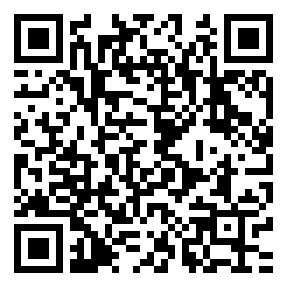
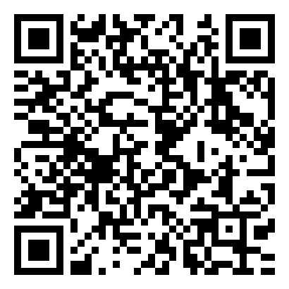

# 🔋 BatteryHealth3DS 

> **Creado y desarrollado por [ElVichoPo (@vicente134)](https://github.com/vicente134)**  
> ⭐ **¿Te gustó la aplicación o te ayudó a diagnosticar tu consola? ¡No olvides dejarle una Estrella (Star) de favorito arriba a la derecha en el repositorio para apoyar el proyecto!** ⭐

---

**BatteryHealth3DS** es una herramienta interactiva de diagnóstico de batería y analizador de resistencia interna (*Voltage Sag Test*) diseñada en C (`libctru` + `citro2d` + `NDSP`) para toda la familia **Nintendo 3DS y 2DS** (`Old 3DS`, `Old 3DS XL`, `Old 2DS`, `New 3DS`, `New 3DS XL` y **`New 2DS XL`**).

Cuenta con **Bati Bot**, un mini asistente interactivo animado en la pantalla táctil que mueve los ojos, parpadea, reproduce efectos de sonido (`"Woupp!"`), incluye música relajante de fondo (`ON / OFF`), detecta automáticamente el idioma de tu consola (`ES / EN / PT / FR`) y te da **10 consejos de emergencia y cuidado** para tu batería.

---

## 🚀 3 Formas de Instalar y Ejecutar en tu 3DS / 2DS

### Opción 1: 📡 Enviar por Wi-Fi con `3dslink` (Recomendado — Guarda la app en tu Homebrew Launcher)

Cuando envías la aplicación por **`3dslink`**, tu consola la abre al instante **y además la guarda automáticamente en tu tarjeta SD (`SD:/3ds/`)** para siempre:

1. En tu consola 3DS / 2DS, abre **The Homebrew Launcher** y presiona el botón **`Y`** (*NetLoader*). Verás en pantalla la **IP de tu consola** (por ejemplo `192.168.1.40`, puerto `17491`).
2. En tu PC (Windows, Linux o Mac):
   - **Si ya tienes `3dslink` (devkitPro) instalado:**
     ```bash
     3dslink -a <IP_DE_TU_CONSOLA> BatteryHealth3DS.3dsx
     ```
   - **Si NO tienes `3dslink` instalado:** Puedes usar el script automático incluido en este repositorio ([`send_to_3ds.py`](send_to_3ds.py)), que descarga el `.3dsx` y lo envía por Wi-Fi usando solo Python:
     ```bash
     python3 send_to_3ds.py <IP_DE_TU_CONSOLA>
     ```

---

### Opción 2: 💾 Copiar a la Tarjeta MicroSD o Descarga Directa (Sin cámara)

Si prefieres descargar el archivo en tu PC o celular y pasarlo a tu tarjeta MicroSD (o por **FTPD**):

- 🎮 **Para The Homebrew Launcher (`.3DSX` — Recomendado y 100% compatible):**  
  👉 [**Descargar `BatteryHealth3DS.3dsx` (Enlace Directo)**](https://github.com/vicente134/BatteryHealth3DS/releases/latest/download/BatteryHealth3DS.3dsx)  
  *(Cópialo dentro de la carpeta **`/3ds/`** de tu tarjeta MicroSD y ábrelo desde **The Homebrew Launcher**).*

- 📦 **Para instalar en el Menú HOME (`.CIA`):**  
  👉 [**Descargar `BatteryHealth3DS.cia` (Enlace Directo)**](https://github.com/vicente134/BatteryHealth3DS/releases/latest/download/BatteryHealth3DS.cia)  
  *(Cópialo dentro de la carpeta **`/cias/`** de tu MicroSD e instálalo con **FBI**).*

- 📂 **Ver todas las versiones y notas de lanzamiento:**  
  👉 [**Ir a la página de Releases en GitHub**](https://github.com/vicente134/BatteryHealth3DS/releases/latest)

---

### Opción 3: 📷 Códigos QR para Descarga desde la Consola (No caducan)

Estos códigos QR están alojados directamente en GitHub y nunca caducan:

| QR para `.3DSX` (Universal-Updater / Navegador) | QR para `.CIA` (FBI -> Remote Install -> Scan QR) |
| :---: | :---: |
|  |  |
| Descarga `BatteryHealth3DS.3dsx` | Descarga `BatteryHealth3DS.cia` |

---

## ✨ Características Principales

- 🔍 **Detección Exacta de Consola y Batería de Fábrica (`CFGU`):**
  - `Old 3DS` / `Old 2DS` / `New 2DS XL` $\rightarrow$ **CTR-003 (1300 mAh / 3.7V)**
  - `Old 3DS XL` / `New 3DS XL` $\rightarrow$ **SPR-003 (1750 mAh / 3.7V)**
  - `New 3DS` estándar $\rightarrow$ **KTR-003 (1400 mAh / 3.7V)**
- ⚡ **Telemetría Dual Precisa (`mcu::HWC` + `ptm:u`) y Gráfica en Vivo:**
  - Lee directamente el registro I2C del MCU para obtener el **voltaje real en milivoltios ($\text{mV}$)** y el porcentaje exacto de carga ($0\text{–}100\%$), dibujando una curva en vivo en la pantalla superior.
- 🔥 **Test de Resistencia Interna / Caída de Tensión (*Voltage Sag Test*):**
  - Mide el voltaje en reposo durante 1 segundo, activa el modo **Turbo 804 MHz** en consolas *New* y somete la CPU/FPU a 5 segundos de carga máxima para medir la caída $\Delta V = V_{\text{reposo}} - V_{\text{mínimo}}$:
    - **$\Delta V \le 60\text{ mV}$:** 🟢 **Salud Excelente** (baja resistencia interna).
    - **$60\text{ mV} < \Delta V \le 150\text{ mV}$:** 🟡 **Desgaste Moderado** (envejecimiento químico normal).
    - **$\Delta V > 150\text{ mV}$ (o caída de barras):** 🔴 **Salud Crítica** (recomendación amigable de reemplazo).
- 🤖 **Asistente Interactivo "Bati Bot":**
  - Animación de respiración, movimiento de pupilas y parpadeo en tiempo real.
  - Tócalo con el lápiz táctil para escuchar su sonido `"Woupp!"` y recorrer sus **10 consejos de emergencia y cuidado**.
  - Música ambiental integrada con botón táctil **`♪ ON / OFF [Y]`**.
  - Soporte multilenguaje con detección automática del sistema (**Español, Inglés, Portugués y Francés**) y cambio rápido con **`SELECT`**.
  - Pantalla de despedida positiva al salir con **`START`**.

---

---

## ❤️ Créditos y Apoyo

- **Autor / Creador:** **ElVichoPo** ([@vicente134](https://github.com/vicente134))
- ⭐ **¡Si te gusta BatteryHealth3DS y Bati Bot, regálale una estrella (`Star`) al repositorio en GitHub!**
